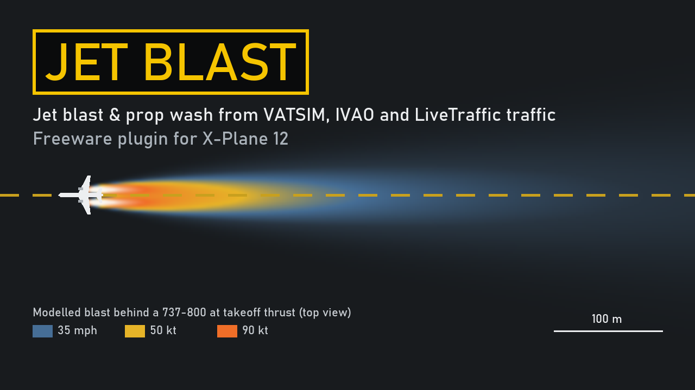

# Jet Blast for X-Plane 12



Jet blast and prop wash from **online and plugin traffic**: VATSIM and IVAO (through xPilot or swift), LiveTraffic, and anything else that uses X-Plane's TCAS traffic API.

X-Plane 12 already gives this traffic a wake in the air, but nothing comes out of its engines on the ground. With Jet Blast, if you taxi or line up too close behind an aircraft that's breaking away or taking off, its exhaust pushes your aircraft sideways, rolls it and swings it around.

**[⬇ Download the latest release](https://github.com/enimri/xplane-jet-blast-releases/releases/latest)**

Jet Blast is published by its author, **enimri**, on GitHub (this page) and on **x-plane.to** (X-Plane Mods, uploaded by *enimri*). Both are official; any other upload is not.

## Features
- Works with any traffic shown through the TCAS API. X-Plane's own AI aircraft are included too (you can turn that off).
- Thrust is estimated from each aircraft's motion: idle, breakaway, takeoff, reverse thrust after landing, and engines off when the beacon is off.
- **With LiveTraffic**, its real flight phase is used instead (take-off roll, landing roll with reversers...), so blast starts and stops at the right moment.
- **Settings per aircraft:** for example full blast in the C172, gentle in the A320, switched automatically when you load the aircraft.
- Engine data for 451 aircraft types, from the C172 to the A380, including props, rear-engine jets, bizjets, military types and 41 helicopters. The list updates itself from GitHub, so new types arrive without a new plugin version.
- Jet blast reach calibrated against ICAO published distances (see *Accuracy* below).
- One-click presets: **Realistic**, **Gentle**, **Event mode** for crowded VATSIM/IVAO events, and **Off**.
- **Auto Event mode:** switches to Event behaviour by itself when a crowd builds up around you, and back when it clears.
- **Jet blast warning:** X-Plane's voice says "Caution, jet blast" and a banner names the aircraft when strong blast reaches you.
- **VR:** all Jet Blast windows open inside your headset.
- **Helicopter downwash:** hovering, landing and departing helicopters blow you around with their rotor wash, from a gentle R44 to a Mi-26 hurricane.
- Blast that hugs the ground, with random gusts.
- Debug window listing every aircraft blowing on you, with its estimated thrust and the blast speed in knots.
- Settings window inside X-Plane, a one-click bug report, and an update check.

## Install
1. Download `JetBlast-vX.Y.Z.zip` from [Releases](https://github.com/enimri/xplane-jet-blast-releases/releases).
2. Unzip it into `X-Plane 12/Resources/plugins/`, so you get:
   ```
   plugins/JetBlast/win_x64/JetBlast.xpl   (Windows)
   plugins/JetBlast/mac_x64/JetBlast.xpl   (macOS, Intel and Apple Silicon)
   plugins/JetBlast/lin_x64/JetBlast.xpl   (Linux)
   plugins/JetBlast/jetblast.ini
   plugins/JetBlast/jetblast_types.csv
   ```
   X-Plane picks the right one for your system automatically.
3. Start X-Plane 12. The menu is **Plugins ▸ Jet Blast**.

Requirements: X-Plane 12 on Windows 64-bit, macOS 11 or newer, or 64-bit Linux. Nothing else needs installing.

**macOS:** the plugin isn't signed with a paid Apple certificate, so macOS may block it the first time. If X-Plane says the plugin couldn't load, open Terminal and run this once (adjust the path to your X-Plane folder):
```
xattr -dr com.apple.quarantine "/Applications/X-Plane 12/Resources/plugins/JetBlast"
```

## Settings
Open **Plugins ▸ Jet Blast ▸ Settings...** in X-Plane. Click **−** / **+** or **ON/OFF** to change a setting; it takes effect immediately. Then keep it:

- **Save for this aircraft:** used automatically whenever you fly this aircraft, for example full blast in the C172 and Gentle in the A320.
- **Save as default:** used for every aircraft that has no settings of its own.
- **Use default settings** (shown when the aircraft has its own): forget this aircraft's settings.

The window shows which settings are active. Per-aircraft settings cover strength, blast reach, gustiness, range, the idle-traffic filter and your aircraft's size. Everything else is the same for all aircraft. They're stored in `jetblast_profiles.ini`, one section per aircraft. Updates never touch that file.

**Presets** (top row of the Settings window):

| Preset | What it does |
|---|---|
| **Realistic** | Full calibrated blast (the default) |
| **Gentle** | Half strength, less gusty, 1 km range |
| **Event mode** | For crowded VATSIM/IVAO events: 40 % strength, 600 m range, and aircraft at idle are ignored, so a busy holding point stays flyable while breakaway and takeoff blast still count |
| **Off** | Switches Jet Blast off |

Change any value by hand and the preset shows as *custom*.

**Auto Event mode** (on by default): when **15 or more aircraft** are within 2 km of you for 10 seconds, as at a busy VATSIM/IVAO event, Jet Blast switches to Event-mode behaviour by itself. It switches back once fewer than 10 remain for 30 seconds, and those delays stop it flickering in a fluctuating crowd.

- It only ever makes the blast **gentler**: each value becomes the weaker of your own setting and Event mode's.
- It never changes your saved settings.
- The Settings and debug windows show whether it's active and how many aircraft are around you.
- Change the crowd size or switch it off in Settings (*Auto Event mode in crowds*, *Crowd size*).

You can also edit `jetblast.ini` directly, then choose **Plugins ▸ Jet Blast ▸ Reload settings**.

| Setting | What it does |
|---|---|
| `intensity` | Strength of all forces on your aircraft (1.0 = normal) |
| `jet_constant` | How far the blast reaches (7 = default; 8–9 = further) |
| `gustiness` | How much the blast gusts (0 = steady) |
| `max_range_m` | Ignore traffic farther away than this |
| `min_thrust` | Ignore traffic below this thrust (0 = none; Event mode uses 0.15) |
| `include_xplane_ai` | Also use X-Plane's own AI traffic |
| `user_span_m`, `user_length_m` | Your aircraft size if auto-detection is wrong (0 = auto, ini file only) |
| `check_updates` | Check for a newer Jet Blast version when X-Plane starts |
| `heli_downwash` | Helicopters push you with their rotor downwash (1 = on) |
| `use_livetraffic` | Use LiveTraffic's flight phase for its aircraft (1 = on) |
| `auto_event`, `auto_event_count` | Auto Event mode on/off, and how many aircraft within 2 km count as a crowd (15) |

## LiveTraffic
If [LiveTraffic](https://forums.x-plane.org/files/file/49749-livetraffic/) is running, Jet Blast reads each aircraft's flight phase from it: parked, taxi, take-off roll, climb, approach, landing roll, plus how far the reversers are open. That replaces the guess from motion:

- **Take-off blast starts as the roll begins**, not seconds later once the aircraft has visibly sped up.
- **Reverse thrust after landing** is picked up from the reversers, so the blast is thrown forward during the roll-out.
- **Taxiing aircraft** never produce take-off blast.

The debug window marks these aircraft with **LT**. No setup is needed; turn it off with *Use LiveTraffic flight phase* in Settings. Online-network traffic (VATSIM/IVAO) doesn't publish flight phases, so it keeps the motion-based estimate.

## Updates
**With SkunkCrafts Updater (easiest):** if you use the [SkunkCrafts Updater](https://forums.x-plane.org/files/file/76763-skunkcrafts-updater/) plugin, Jet Blast appears in its list automatically from v1.3.2 on. Click update there and it fetches the new version for you. Your `jetblast.ini` and `jetblast_types.csv` are never overwritten. If you installed an older version, install v1.3.2 or newer by hand once; after that SkunkCrafts takes over.

**After an update**, a small *What's new* window opens once, a few seconds after X-Plane starts, listing what changed. Reopen it any time with **Plugins ▸ Jet Blast ▸ What's new**.

**Without SkunkCrafts:** when X-Plane starts, Jet Blast asks GitHub once whether a newer version exists. If there is one, the menu changes to **Jet Blast (update available)** and the Settings window shows where to download it. Nothing is installed automatically.

At the same time it downloads the latest **aircraft data** (the type list). A newer list is checked for damage, saved as `jetblast_typedb_latest.csv` and used straight away. That's the only thing updated automatically, and it's only data, never program code.

Both checks send no personal data; turn them off in Settings or with `check_updates = 0`.

## Aircraft data
`jetblast_typedb.csv` holds size, weight, thrust and engine layout for 451 types. Don't edit it; your changes would be replaced by updates. To add or fix a type, put a row in `jetblast_types.csv` instead (the format is explained inside the file). Your rows always win over the database.

## Accuracy
Blast reach for jets is calibrated against the distances behind the tail at which the blast falls to 56 km/h (35 mph), as listed in ICAO Doc 9157 *Aerodrome Design Manual* Part 2, Table A2-1, for idle, breakaway and takeoff thrust:

| | Idle | Breakaway | Takeoff |
|---|---|---|---|
| A320 | 17.5 m | 48 m | 380 m |
| 737-8 | 19 m | 56 m | 334 m |
| 777-300ER | 43 m | 99 m | 689 m |
| 747-8 | 22 m | 98 m | 789 m |
| MD-11 | 65 m | 160 m | 564 m |
| A380 | 45 m | 88 m | 429 m |

These six match to within about 1 %. All other jets use a curve fitted to these six by total thrust, so expect roughly ±30–50 % for them. Helicopter downwash uses rotor momentum theory: hovering, a Black Hawk gives about 30 kt one rotor width away and about 17 kt at 50 m, in line with published rotorwash surveys. Propeller wash is not calibrated (there's no equivalent published table), and the aircraft dimensions and thrust figures are rounded public values. Thrust is still estimated from how each aircraft moves, so real-world accuracy also depends on that guess.

## Known limitations
- Networks don't send engine data, so thrust is estimated from motion. A static run-up on the brakes isn't detected unless the traffic source sends throttle data.
- Blast affects your aircraft only. Other traffic isn't pushed.
- The macOS and Linux versions are new and have only been build-tested so far. Reports from Mac and Linux users are especially welcome.

## Problems or ideas?
Choose **Plugins ▸ Jet Blast ▸ Copy bug report** right after the problem happens. Then **[report the bug here](https://github.com/enimri/xplane-jet-blast-releases/issues/new?template=bug_report.yml)** and paste it into the form, or reply in the forum thread. It contains your Jet Blast version and settings, your aircraft type, the traffic around you and recent Jet Blast log lines. It never includes your name, account, location or files. The same report is also saved as `jetblast_bugreport.txt` in the plugin folder.

## License
Freeware: free to download and use, closed source. Official downloads: this GitHub page and x-plane.to (uploaded by enimri). Jet Blast works with VATSIM, IVAO and LiveTraffic traffic but is not affiliated with or endorsed by them. See [LICENSE.txt](LICENSE.txt). Jet Blast includes LiveTraffic's LTAPI (MIT licence); see `THIRD_PARTY_NOTICES.txt`.
